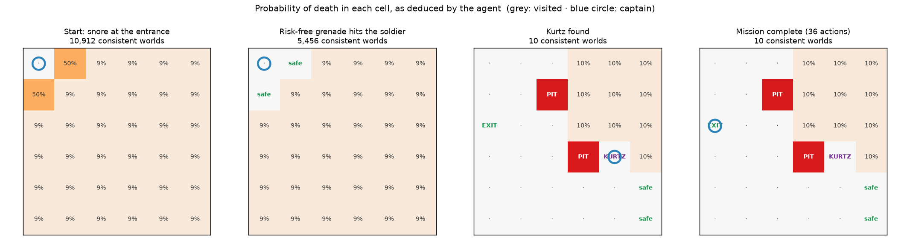
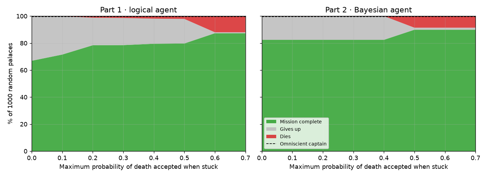
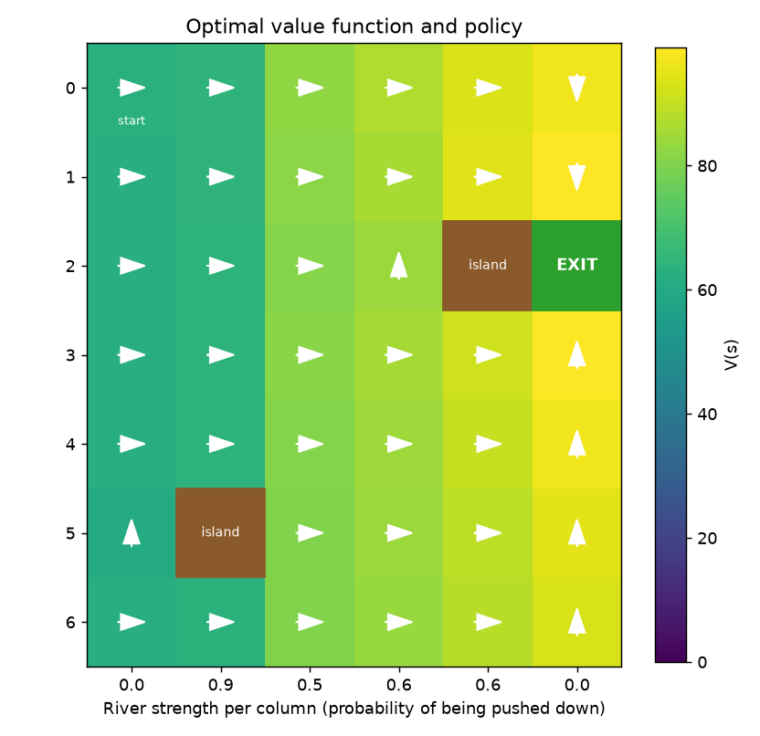
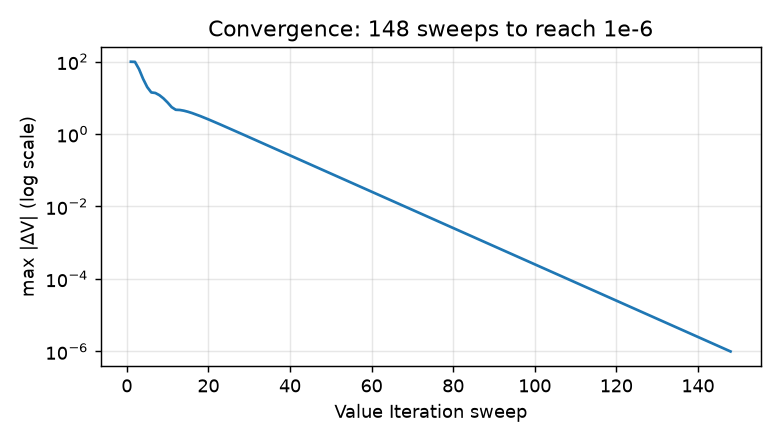

[English](README.md) | **Español**

# Agentes de IA bajo incertidumbre: buscando al Coronel Kurtz

Tres técnicas clásicas de inteligencia artificial aplicadas a una misma historia, inspirada en *Apocalypse Now*. El Capitán Willard debe encontrar al Coronel Kurtz en un palacio oscuro lleno de trampas ocultas y después cruzar un río peligroso:

| Parte | Problema | Técnica |
|---|---|---|
| 1 · Lógica | Explorar un palacio de 6 × 6 con 3 precipicios ocultos y un soldado dormido, percibiendo solo pistas locales (brisa, ronquidos, resplandor) | Inferencia proposicional por **model checking** + planificación con **BFS** sobre celdas demostradas seguras |
| 2 · Bayes | El mismo palacio con tres trampas distintas que pueden compartir celda | **Filtrado bayesiano** de la posición de cada elemento + planificación según el riesgo |
| 3 · MDP | Cruzar un río cuya corriente arrastra la barca río abajo | **Proceso de Decisión de Markov** resuelto con **Value Iteration** |

Los agentes autónomos actúan **solo con lo que perciben**: nunca ven el mapa. En 1.000 palacios aleatorios, el agente lógico prudente completa la misión en el **67 %** de ellos **sin morir nunca**, y el agente bayesiano en el **82 %**.

> Proyecto final individual de *Fundamentos de la Inteligencia Artificial*, 2º curso del Grado en Ingeniería Matemática e Inteligencia Artificial, ICAI – Universidad Pontificia Comillas (curso 2025/26). El código tal como se entregó en la asignatura está en [`original/`](original/); esta versión lo amplía (ver [Qué ha cambiado](#qué-ha-cambiado-respecto-a-la-entrega-de-la-asignatura)).


<p align="center">
  
</p>

*Una partida del agente lógico, vista a través de su propio conocimiento. Cada número es la probabilidad exacta de que entrar en esa celda sea mortal. Al principio, un ronquido indica que el soldado está en una de las dos celdas vecinas (50 % cada una). El agente lanza la granada a una de ellas: pase lo que pase, aprende algo sin correr ningún riesgo. Después deduce dónde están dos precipicios, encuentra a Kurtz y sale por la salida. El conjunto de mundos posibles pasa de 209.440 a 10.*

---

## Parte 1 · Agente lógico (model checking)

**El palacio.** Tiene 6 × 6 celdas: 3 precipicios, 1 soldado dormido, el Coronel Kurtz y la salida, cada uno en una celda aleatoria distinta. Willard empieza en la esquina superior izquierda. Percibe una **brisa** junto a un precipicio, **ronquidos** junto al soldado, un **resplandor** en la salida o junto a ella, las paredes, y un **grito** si su única granada alcanza al soldado.

**Base de conocimiento.** Un *modelo* es una posible colocación de los precipicios y el soldado. Hay C(35, 3) × 32 = **209.440**. La base de conocimiento los guarda todos como máscaras de bits en arrays de NumPy y, tras cada percepción, descarta los que la contradicen:

- brisa en *c* ⇔ hay algún precipicio adyacente a *c*
- ronquido en *c* ⇔ el soldado vivo está adyacente a *c*
- vivo en *c* ⇒ no hay precipicio ni soldado vivo en *c*
- grito ⇔ la granada alcanzó la celda del soldado

Una afirmación se *deduce* cuando se cumple en todos los modelos restantes. Una celda es **segura** cuando ningún modelo la hace mortal, y un precipicio o el soldado quedan **localizados** cuando todos los modelos coinciden. Así se reproduce exactamente el razonamiento del ejemplo del enunciado, por ejemplo "el soldado tiene que estar en (3,1)".

**Probabilidades gratis.** Como los elementos se colocan de forma uniforme y aleatoria, todos los modelos coherentes son igual de probables. La proporción de modelos con un precipicio en una celda es, por tanto, el **posterior bayesiano exacto** P(precipicio | percepciones). Un test lo comprueba frente a 60.000 palacios muestreados de forma independiente.

## Parte 2 · Agente bayesiano

Ahora hay tres trampas distintas (fuego, pinchos y dardos envenenados), cada una con su propio estímulo, y pueden compartir celda. El soldado, la salida y Kurtz nunca comparten celda con una trampa, pero sí pueden compartirla entre ellos. Para cada elemento, el agente mantiene un mapa de probabilidad que empieza uniforme (1/35 por celda) y se actualiza con la regla de Bayes tras cada percepción. La verosimilitud es determinista (el estímulo se percibe si y solo si el elemento está en la celda o al lado), así que cada actualización pone a cero las celdas incompatibles y renormaliza. El agente también usa el hecho de seguir vivo: las celdas que ha visitado no tienen trampas. El riesgo de una celda es P(muerte) = 1 − ∏(1 − P(elemento)).

## El agente autónomo (Partes 1 y 2)

El mismo agente juega en los dos palacios; solo cambia la base de conocimiento. En cada paso vuelve a planificar:

1. **Con Kurtz a bordo y la salida localizada** → camino seguro más corto hasta la salida, y sale.
2. **Explorar** → ir a la celda segura no visitada más cercana (con **BFS** sobre celdas seguras). Una vez encontrado Kurtz, se priorizan las celdas con más probabilidad de ser la salida.
3. **Granada sin riesgo** → si la posición del soldado está deducida, o una celda vecina solo puede ser mortal por él, lanza la granada ahí. O lo mata, o demuestra que la celda es segura.
4. **Riesgo calculado** (opcional) → entra en la celda sin explorar con menor probabilidad de muerte, si está por debajo de un umbral.
5. Si no, **se rinde** antes que jugársela.

## Resultados

**Agentes del palacio: 1.000 palacios aleatorios por configuración** (`python scripts/evaluate_agents.py`)

<p align="center">
  
</p>

| Agente | Riesgo máx. aceptado | Misión completada | Muere | Se rinde |
|---|---|---|---|---|
| Lógico (Parte 1) | 0 (prudente) | **66,9 %** | **0 %** | 33,1 % |
| Lógico (Parte 1) | 0,2 | 78,4 % | 1,2 % | 20,4 % |
| Lógico (Parte 1) | 0,6 | 87,3 % | 12,0 % | 0,7 % |
| Bayesiano (Parte 2) | 0 (prudente) | **82,4 %** | **0 %** | 17,6 % |
| Bayesiano (Parte 2) | 0,5 | 89,9 % | 8,6 % | 1,5 % |
| Capitán omnisciente (conoce el mapa) | – | 99,5 % | – | – |

- **El agente prudente nunca muere.** Cada movimiento que hace está demostrado lógicamente como seguro.
- **La mayoría de los fallos ocurren en el primer movimiento.** Si el capitán siente una brisa en la entrada, las dos celdas vecinas tienen ≈ 50 % de probabilidad de esconder un precipicio y no queda nada que deducir. Es el dilema clásico del *Wumpus World*, y por eso el éxito solo se dispara cuando el agente acepta riesgos de cara o cruz (≥ 0,5–0,6), a costa de muchas más muertes.
- **Un poco de riesgo compensa:** aceptar hasta un 20 % de riesgo sube el éxito del 67 % al 78 % con solo un 1,2 % de muertes.
- **La Parte 2 es más fácil para un agente prudente** (82 % frente a 67 %) porque cada trampa tiene su propio estímulo y las trampas pueden solaparse, así que hay menos celdas mortales distintas y pistas más informativas.

## Parte 3 · Cruzar el río (MDP)

Los estados son las posiciones de la barca en una cuadrícula de 7 × 6 con 2 islas. Las acciones son arriba, abajo, izquierda, derecha y quedarse. La corriente de la columna *j* empuja la barca una celda hacia abajo con probabilidad `river_strength(j)` (0 en las orillas). Las recompensas son +100 en la salida y −1 por paso. **Value Iteration** (γ = 0,99) calcula el valor óptimo V(s) y la política π(s).

<p align="center">
  
  
</p>

- **La política rodea los obstáculos y aprovecha la orilla en calma.** En (2, 3) la isla bloquea el paso hacia la derecha, así que la barca sube primero. Por debajo de la salida, cruza el río donde está y luego sube por la última columna, que no tiene corriente.
- **Una trampa creada por la corriente:** la columna 1 tiene una corriente de 0,9 y una isla justo debajo de (4, 1). En esa celda, cualquier acción distinta de "abajo" solo sale bien el 10 % de las veces (el resto, la corriente empuja la barca contra la isla y se queda quieta), así que puede quedarse atascada varios turnos. La simulación de `python river_mdp.py --seed 3` muestra justo esto.
- **Convergencia:** Value Iteration converge de forma geométrica, en 148 iteraciones en este ejemplo.
- **Monte Carlo sobre 200 ríos aleatorios × 50 episodios** (`python scripts/river_analysis.py`): la política óptima llega a la salida en menos de 200 pasos en el **98,8 %** de los episodios, frente al **87,5 %** de una política ingenua de "nadar siempre a la derecha".

## Estructura del repositorio

```
ai-agents-under-uncertainty/
├── kurtz.py                # Parte 1: jugar, o ver jugar al agente lógico (--auto)
├── palacio.py              # Parte 2: palacio bayesiano (--auto, --plots)
├── river_mdp.py            # Parte 3: MDP + Value Iteration (código de la asignatura)
├── palace_ai/
│   ├── palace.py           # Entornos: palacios de las Partes 1 y 2, percepciones y reglas
│   ├── knowledge.py        # Base de conocimiento de la Parte 1: model checking sobre 209.440 mundos
│   ├── bayes.py            # Creencias bayesianas de la Parte 2
│   ├── agent.py            # Agente autónomo común a los dos palacios
│   ├── grid.py             # Geometría de la cuadrícula y BFS
│   └── cli.py              # Interfaz por consola (modos interactivo y automático)
├── scripts/
│   ├── evaluate_agents.py  # Evaluación en 1.000 palacios → docs/results.csv + figura
│   ├── episode_figure.py   # Figura del razonamiento del agente durante una partida
│   └── river_analysis.py   # Figuras del río y comparación Monte Carlo
├── tests/                  # pytest: corrección, posteriors exactos, seguridad, MDP
├── original/               # Código tal como se entregó en la asignatura
├── report/report_es.pdf    # Memoria de la asignatura
└── docs/                   # Figuras y resultados
```

## Cómo reproducir los resultados

**Requisitos:** Python 3.12.

1. **Clonar el repositorio e instalar las dependencias**
   ```bash
   git clone https://github.com/jimenazubii/ai-agents-under-uncertainty.git
   cd ai-agents-under-uncertainty
   python3.12 -m venv .venv
   source .venv/bin/activate          # Windows: .venv\Scripts\activate
   pip install -r requirements.txt
   ```

2. **Jugar o ver jugar a los agentes**
   ```bash
   python kurtz.py                         # guías tú a Willard; el mapa muestra lo que ha deducido
   python kurtz.py --auto --seed 4         # el agente lógico juega la partida de la figura
   python palacio.py --auto --risk 0.5     # agente bayesiano que acepta hasta un 50 % de riesgo
   python palacio.py --plots               # jugar viendo los mapas de calor de las creencias
   python river_mdp.py --seed 3            # el río de la figura: política y una simulación
   ```
   En modo interactivo: `w a s d` para moverse, `g` + dirección para lanzar la granada (p. ej. `gd`), `x` para salir y `h` para pedir una pista al agente.

3. **Ejecutar los tests** (unos 15 s)
   ```bash
   python -m pytest
   ```
   Comprueban que todas las deducciones son correctas en partidas aleatorias, que las probabilidades coinciden con un muestreo independiente, que el agente prudente nunca muere y que el MDP está bien definido.

4. **Reproducir las figuras y las cifras**
   ```bash
   python scripts/evaluate_agents.py   # ≈ 3 min; tabla de resultados y docs/results.csv
   python scripts/episode_figure.py    # agent_reasoning.png (semilla 4)
   python scripts/river_analysis.py    # figuras del río; Monte Carlo 98,8 % frente a 87,5 %
   ```
   Cada palacio y cada río se generan a partir de una semilla fija, así que los resultados son idénticos en cada ejecución.

## Qué ha cambiado respecto a la entrega de la asignatura

El código original (en [`original/`](original/)) implementaba las tres partes como juegos interactivos por consola. Al revisarlo para este portfolio encontré estas limitaciones y las corregí:

| Versión de la asignatura | Esta versión |
|---|---|
| El "agente de búsqueda" ejecutaba BFS sobre el **mapa real**, así que sabía dónde estaba cada precipicio. | El agente solo usa sus percepciones; BFS se ejecuta sobre las celdas que la base de conocimiento ha **demostrado** seguras. |
| La base de conocimiento solo marcaba una celda como segura **después de visitarla**, nunca deducía la posición del soldado ni de un precipicio, y podía olvidar una celda que ya había descartado. | Inferencia exacta por model checking: deduce celdas seguras, localiza precipicios y al soldado, y nunca pierde información. |
| La Parte 2 no usaba que las celdas visitadas no tienen trampas. El agente bayesiano de búsqueda estaba en `extras/`, no estaba conectado al programa y lanzaba la granada con un 35 % de confianza. | Se añade la evidencia de supervivencia; un único agente para los dos palacios, con una granada que solo se lanza cuando no supone ningún riesgo (o cuando el soldado está localizado). |
| No había evaluación: los resultados se mostraban con capturas de partidas sueltas. | Evaluación en 1.000 palacios aleatorios, Monte Carlo para el río y tests automáticos. |
| Faltaban los gráficos y el análisis del río. | Figuras de V(s), de la política y de la convergencia, y comparación con una política de referencia. |

El MDP del río (`river_mdp.py`) es el código de la asignatura, solo con la opción `--seed` añadida.

## Autora

**Jimena Zubizarreta**, Grado en Ingeniería Matemática e Inteligencia Artificial, ICAI – Universidad Pontificia Comillas, Madrid. La historia y el planteamiento del problema proceden del enunciado de la asignatura.
