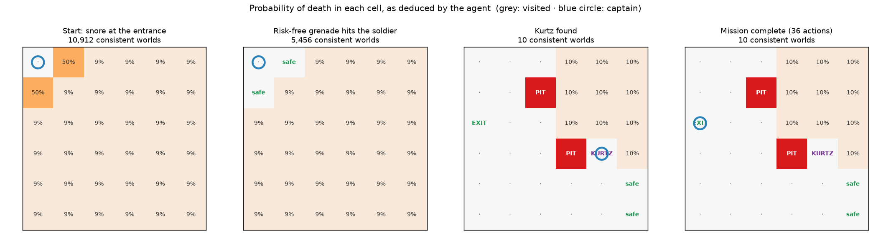
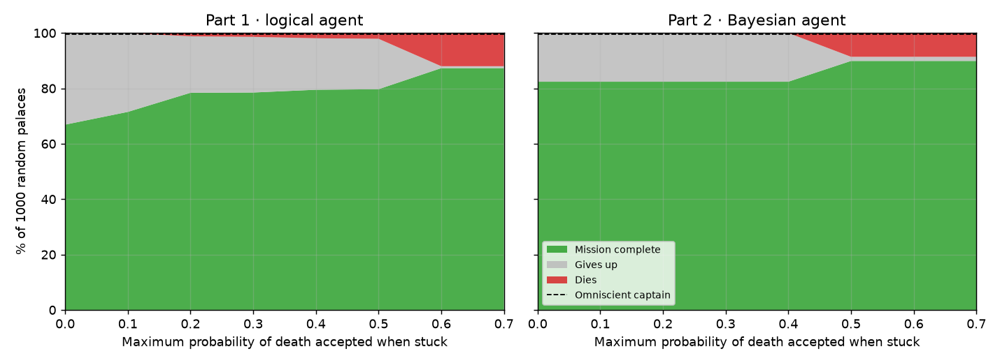
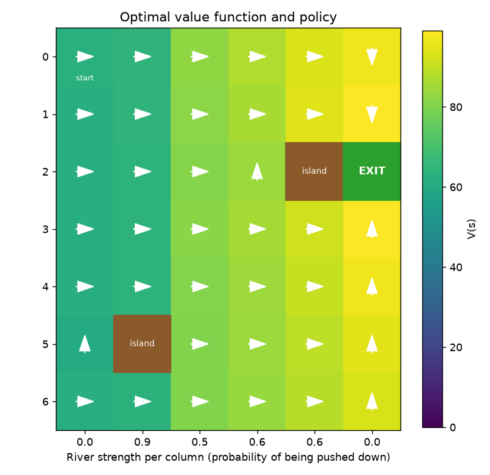
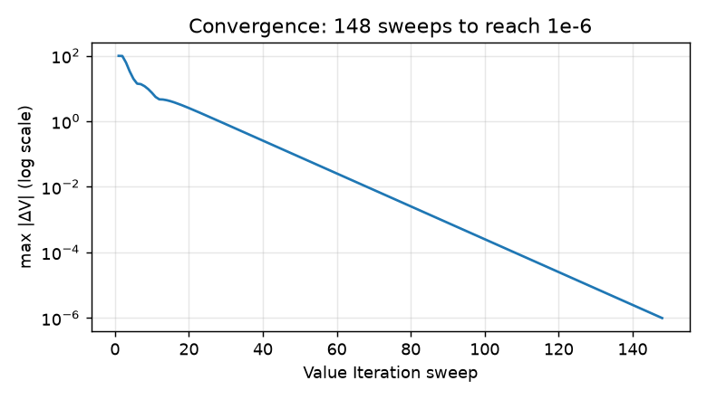

**English** | [Español](README.es.md)

# AI Agents Under Uncertainty: Finding Colonel Kurtz

Three classic AI techniques applied to one story, inspired by *Apocalypse Now*. Captain Willard must find Colonel Kurtz in a dark palace full of hidden traps and then cross a dangerous river:

| Part | Problem | Technique |
|---|---|---|
| 1 · Logic | Explore a 6 × 6 palace with 3 hidden pits and a sleeping soldier, perceiving only local clues (breeze, snoring, glow) | Propositional inference by **model checking** + **BFS** planning over cells proved safe |
| 2 · Bayes | Same palace with three different traps that may share a cell | **Bayesian filtering** of each element's position + risk-aware planning |
| 3 · MDP | Cross a river whose current pushes the boat downstream | **Markov Decision Process** solved with **Value Iteration** |

The autonomous agents act **only on their percepts**: they never see the map. Over 1,000 random palaces, the cautious logical agent completes the mission in **67 %** of them **without ever dying**, and the Bayesian agent in **82 %**.

> Individual final project for *Foundations of Artificial Intelligence (Fundamentos de la Inteligencia Artificial)*, 2nd year of the BSc in Mathematical Engineering and Artificial Intelligence, ICAI – Universidad Pontificia Comillas (2025/26). The code as submitted for the course is kept in [`original/`](original/); this version extends it (see [What changed](#what-changed-since-the-course-submission)).


<p align="center">
  
</p>

*One game of the logical agent, seen through its own knowledge. Each number is the exact probability that entering that cell is deadly. At the start, a snore means the soldier is in one of the two neighbouring cells (50 % each). The agent throws its grenade into one of them: whatever happens, it learns something without any risk. It then deduces the location of two pits, finds Kurtz and leaves through the exit. The set of possible worlds shrinks from 209,440 to 10.*

---

## Part 1 · Logical agent (model checking)

**The palace.** 6 × 6 cells: 3 pits, 1 sleeping soldier, Colonel Kurtz and the exit, each in a different random cell. Willard starts in the top-left corner. He perceives a **breeze** next to a pit, **snoring** next to the soldier, a **glow** at or next to the exit, the walls, and a **scream** if his only grenade hits the soldier.

**Knowledge base.** A *model* is one possible placement of the pits and the soldier. There are C(35, 3) × 32 = **209,440** of them. The knowledge base stores them all as bitmasks in NumPy arrays and, after every percept, discards the models that contradict it:

- breeze at *c* ⇔ some pit is adjacent to *c*
- snore at *c* ⇔ the living soldier is adjacent to *c*
- alive in *c* ⇒ no pit and no living soldier in *c*
- scream ⇔ the grenade hit the soldier's cell

A statement is *entailed* when it holds in every remaining model. A cell is **safe** when no model makes it deadly, and a pit or the soldier is **located** when all models agree. This reproduces exactly the reasoning in the assignment's example, e.g. "the soldier must be in (3,1)".

**Free probabilities.** Because the elements are placed uniformly at random, every consistent model is equally likely. The fraction of models with a pit in a cell is therefore the **exact Bayesian posterior** P(pit | percepts). A test checks this against 60,000 palaces sampled independently.

## Part 2 · Bayesian agent

Now there are three different traps (fire, spikes and poisoned darts), each with its own stimulus, and they may share a cell. The soldier, the exit and Kurtz never share a cell with a trap, but they may share one with each other. For each element, the agent keeps a probability map that starts uniform (1/35 per cell) and updates with Bayes' rule after every percept. The likelihood is deterministic (the stimulus is perceived if and only if the element is in the cell or next to it), so each update zeroes the incompatible cells and renormalises. The agent also uses the fact that it is alive: the cells it has visited contain no traps. The risk of a cell is P(death) = 1 − ∏(1 − P(element)).

## The autonomous agent (Parts 1 and 2)

The same agent plays both palaces; only the knowledge base changes. At every step it replans:

1. **Kurtz on board and the exit located** → shortest safe path to the exit and leave.
2. **Explore** → go to the nearest safe, unvisited cell (with **BFS** over safe cells). Once Kurtz is found, cells more likely to be the exit come first.
3. **Grenade without risk** → if the soldier's position is entailed, or a neighbouring cell could only be deadly because of him, throw the grenade there. Either it kills him or it proves the cell safe.
4. **Calculated risk** (optional) → enter the unexplored cell with the lowest probability of death, if it is below a threshold.
5. Otherwise, **give up** rather than gamble.

## Results

**Palace agents: 1,000 random palaces per configuration** (`python scripts/evaluate_agents.py`)

<p align="center">
  
</p>

| Agent | Max. risk accepted | Mission complete | Dies | Gives up |
|---|---|---|---|---|
| Logical (Part 1) | 0 (cautious) | **66.9 %** | **0 %** | 33.1 % |
| Logical (Part 1) | 0.2 | 78.4 % | 1.2 % | 20.4 % |
| Logical (Part 1) | 0.6 | 87.3 % | 12.0 % | 0.7 % |
| Bayesian (Part 2) | 0 (cautious) | **82.4 %** | **0 %** | 17.6 % |
| Bayesian (Part 2) | 0.5 | 89.9 % | 8.6 % | 1.5 % |
| Omniscient captain (knows the map) | – | 99.5 % | – | – |

- **The cautious agent never dies.** Every move it makes is logically proved safe.
- **Most failures happen on the very first move.** If the captain feels a breeze at the entrance, both neighbouring cells have a ≈ 50 % chance of hiding a pit and there is nothing left to deduce. This is the classic *Wumpus World* dilemma, and why success only jumps once the agent accepts coin-flip risks (≥ 0.5–0.6), at the price of many more deaths.
- **A small risk budget pays off:** accepting up to 20 % risk raises success from 67 % to 78 % with only 1.2 % deaths.
- **Part 2 is easier for a cautious agent** (82 % vs 67 %) because each trap has its own stimulus and traps may overlap, so there are fewer distinct deadly cells and more informative clues.

## Part 3 · Crossing the river (MDP)

States are the boat's positions on a 7 × 6 grid with 2 islands. The actions are up, down, left, right and stay. The current of column *j* pushes the boat one cell down with probability `river_strength(j)` (0 at the banks). The rewards are +100 at the exit and −1 per step. **Value Iteration** (γ = 0.99) computes the optimal value V(s) and policy π(s).

<p align="center">
  
  
</p>

- **The policy routes around obstacles and uses the calm bank.** At (2, 3) the island blocks the way to the right, so the boat goes up first. Below the exit, it crosses the river where it is and then climbs along the last column, which has no current.
- **A trap created by the current:** column 1 has a 0.9 current and an island right below (4, 1). In that cell, every action other than "down" succeeds only 10 % of the time (the rest of the time the current pushes the boat against the island and it stays put), so the boat can be stuck there for several turns. The simulation in `python river_mdp.py --seed 3` shows exactly this.
- **Convergence:** Value Iteration converges geometrically, in 148 sweeps in this example.
- **Monte Carlo over 200 random rivers × 50 episodes** (`python scripts/river_analysis.py`): the optimal policy reaches the exit within 200 steps in **98.8 %** of the episodes, versus **87.5 %** for a naive "always swim right" policy.

## Repository structure

```
ai-agents-under-uncertainty/
├── kurtz.py                # Part 1 entry point: play, or watch the logical agent (--auto)
├── palacio.py              # Part 2 entry point: Bayesian palace (--auto, --plots)
├── river_mdp.py            # Part 3 entry point: MDP + Value Iteration (course code)
├── palace_ai/
│   ├── palace.py           # Environments: Part 1 and Part 2 palaces, percepts and rules
│   ├── knowledge.py        # Part 1 knowledge base: model checking over 209,440 worlds
│   ├── bayes.py            # Part 2 Bayesian beliefs
│   ├── agent.py            # Autonomous agent shared by both palaces
│   ├── grid.py             # Grid geometry and BFS
│   └── cli.py              # Console interface (interactive and automatic modes)
├── scripts/
│   ├── evaluate_agents.py  # 1,000-palace evaluation → docs/results.csv + figure
│   ├── episode_figure.py   # Figure of the agent's reasoning during one game
│   └── river_analysis.py   # River figures and Monte Carlo comparison
├── tests/                  # pytest: soundness, exact posteriors, safety, MDP
├── original/               # Code exactly as submitted for the course
├── report/report_es.pdf    # Course report (Spanish)
└── docs/                   # Figures and results
```

## How to reproduce the results

**Requirements:** Python 3.12.

1. **Clone the repository and install the dependencies**
   ```bash
   git clone https://github.com/jimenazubii/ai-agents-under-uncertainty.git
   cd ai-agents-under-uncertainty
   python3.12 -m venv .venv
   source .venv/bin/activate          # Windows: .venv\Scripts\activate
   pip install -r requirements.txt
   ```

2. **Play or watch the agents**
   ```bash
   python kurtz.py                         # you guide Willard; the map shows what he has deduced
   python kurtz.py --auto --seed 4         # the logical agent plays the game shown above
   python palacio.py --auto --risk 0.5     # Bayesian agent that accepts up to 50 % risk
   python palacio.py --plots               # play with the belief heatmaps
   python river_mdp.py --seed 3            # river from the figure: policy and one simulation
   ```
   In interactive mode: `w a s d` to move, `g` + direction to throw the grenade (e.g. `gd`), `x` to leave, `h` for a hint from the agent.

3. **Run the tests** (about 15 s)
   ```bash
   python -m pytest
   ```
   They check that every deduction is correct on random games, that the probabilities match independent sampling, that the cautious agent never dies, and that the MDP is well defined.

4. **Reproduce the figures and numbers**
   ```bash
   python scripts/evaluate_agents.py   # ≈ 3 min; table above and docs/results.csv
   python scripts/episode_figure.py    # agent_reasoning.png (seed 4)
   python scripts/river_analysis.py    # river figures; Monte Carlo 98.8 % vs 87.5 %
   ```
   Every palace and river is generated from a fixed seed, so the results are identical on every run.

## What changed since the course submission

The original code (in [`original/`](original/)) implemented the three parts as interactive console games. Reviewing it for this portfolio, I found these limitations and fixed them:

| Course version | This version |
|---|---|
| The "search agent" ran BFS on the **real map**, so it knew where every pit was. | The agent only uses its percepts; BFS runs over the cells the knowledge base has **proved** safe. |
| The knowledge base marked a cell safe only **after visiting it**, never deduced the soldier's or a pit's position, and could forget a cell it had already cleared. | Exact inference by model checking: it deduces safe cells, locates pits and the soldier, and never loses information. |
| Part 2 did not use the fact that visited cells are trap-free. The Bayesian search agent lived in `extras/`, was not wired to the program, and threw the grenade on a 35 % guess. | Survival evidence added; one agent for both palaces, with a grenade that is only thrown when it is risk-free (or the soldier is located). |
| No evaluation: results were shown with screenshots of single games. | Evaluation on 1,000 random palaces, Monte Carlo for the river, and automated tests. |
| River plots and analysis were missing. | Figures of V(s), the policy and convergence, plus a baseline comparison. |

The river MDP (`river_mdp.py`) is the course code with only a `--seed` option added.

## Author

**Jimena Zubizarreta**, BSc in Mathematical Engineering and Artificial Intelligence, ICAI – Universidad Pontificia Comillas, Madrid. The story and the problem statement come from the course assignment.
